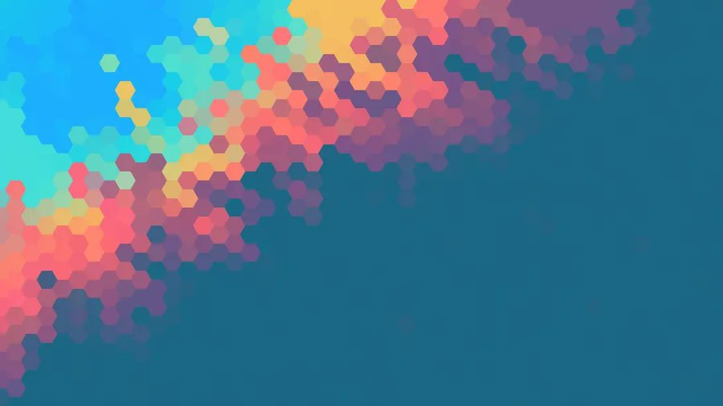

# png2svg

**Convert a raster image into a scalable SVG mosaic made from colored hexagons or triangles.**



`png2svg` is a Python library and command-line application built with Pillow, Marimo, pytest, Ruff, mypy, and `uv`. It reads an image, averages the RGB colors in a regular geometric grid, maps those colors to an optional palette, and writes the result as an SVG document.

The output keeps the source image dimensions and uses vector `<polygon>` elements. It can be opened in an SVG-compatible browser or vector editor and scaled without pixelation.

[](https://github.com/sanaiftikharh/png2svg/actions/workflows/tests.yml)
[](https://github.com/sanaiftikharh/png2svg/actions/workflows/publish.yml)

## Features

- Converts PNG and other Pillow-supported raster images to SVG
- Generates regular hexagons or triangles
- Samples average RGB values from the source image
- Supports custom or built-in color palettes
- Provides a reusable Python function and an object-oriented converter
- Provides a `png2svg` command-line interface
- Creates missing output directories automatically
- Includes an interactive Marimo notebook
- Includes unit tests for geometry, sampling, palettes, SVG generation, the CLI, and the converter
- Runs tests, formatting, linting, typing, coverage, and publication through GitHub Actions

## Example

The repository includes [examples/sample.jpg](examples/sample.jpg), a `900 × 506` sample image.

Generate a sunset-palette triangle mosaic:

```bash
uv run png2svg examples/sample.jpg output/output.svg --shape triangle --radius 5 --palette sunset
```

The converter creates `output/output.svg` locally. Because `output/` is generated output and is ignored by Git, the SVG is not expected to be committed. The output uses a `900 × 506` view box and contains colored triangle polygons.

Other useful examples:

```bash
# Hexagons, 10-pixel radius, original sampled colors
uv run png2svg examples/sample.jpg output/hexagons.svg --shape hexagon --radius 10

# Larger hexagons
uv run png2svg examples/sample.jpg output/large.svg --shape hexagon --radius 20

# Triangles with a grayscale palette
uv run png2svg examples/sample.jpg output/grayscale.svg --shape triangle --radius 8 --palette grayscale

# Triangles with the ocean palette
uv run png2svg examples/sample.jpg output/ocean.svg --shape triangle --radius 8 --palette ocean
```

Smaller radius values create more shapes and usually preserve more visual detail. Larger radius values create fewer, larger shapes and a coarser result.

## Requirements

- Python 3.11 or newer
- `uv` for the recommended development and command workflow
- Pillow, Marimo, pytest, pytest-cov, Ruff, and mypy

## Installation

### From source

```bash
git clone https://github.com/sanaiftikharh/png2svg.git
cd png2svg
uv sync --all-groups
```

Run the package directly through `uv`:

```bash
uv run png2svg --help
```

### Package installation

A package release can be installed with `pip`:

```bash
python -m pip install png2svg
```

## Command-Line Interface

```text
usage: png2svg [-h] [--radius RADIUS] [--shape {hexagon,triangle}]
               [--palette {grayscale,sunset,ocean}]
               input_path output_path
```

### Required arguments

| Argument      | Description                            |
| ------------- | -------------------------------------- |
| `input_path`  | Existing raster image to convert       |
| `output_path` | Destination for the generated SVG file |

### Optional arguments

| Option      | Values                         | Default    |                       Description                        |
| ----------- | ------------------------------ | ---------- | :------------------------------------------------------: |
| `--radius`  | Positive number                | `10`       |      Radius used to generate and sample each shape       |
| `--shape`   | `hexagon`, `triangle`          | `hexagon`  |            Geometric shape used in the mosaic            |
| `--palette` | `grayscale`, `sunset`, `ocean` | No palette | Maps each sampled RGB color to the nearest palette color |

Examples:

```bash
uv run png2svg input.png output.svg
uv run png2svg input.png output.svg --radius 5 --shape triangle
uv run png2svg input.png output.svg --radius 12 --shape hexagon --palette ocean
```

The CLI rejects:

- missing input files
- non-positive radius values
- unknown shapes or palettes
- invalid input and conversion conditions

The output filename should end in `.svg`. The CLI creates missing parent directories for the output path.

## Python API

### Functional API

```python
from png2svg import convert_image_to_svg

convert_image_to_svg(
    input_path="examples/sample.jpg",
    output_path="output/sample.svg",
    radius=10,
    shape="hexagon",
)
```

Triangle conversion:

```python
from png2svg import convert_image_to_svg

convert_image_to_svg(
    input_path="examples/sample.jpg",
    output_path="output/triangles.svg",
    radius=5,
    shape="triangle",
)
```

### Object-Oriented API

```python
from png2svg import PNGToSVGConverter

converter = PNGToSVGConverter(
    radius=8,
    shape="triangle",
)

converter.convert(
    "examples/sample.jpg",
    "output/converter-result.svg",
)
```

### Custom Palette

```python
from png2svg import convert_image_to_svg

palette = [
    (0, 0, 0),
    (128, 128, 128),
    (255, 255, 255),
]

convert_image_to_svg(
    input_path="examples/sample.jpg",
    output_path="output/grayscale.svg",
    radius=10,
    shape="hexagon",
    palette=palette,
)
```

The built-in palettes are:

- **grayscale:** `(0, 0, 0)`, `(128, 128, 128)`, `(255, 255, 255)`
- **sunset:** `(75, 0, 130)`, `(220, 20, 60)`, `(255, 165, 0)`
- **ocean:** `(0, 0, 128)`, `(0, 128, 180)`, `(135, 206, 235)`

## How Conversion Works

1. Pillow opens the source image and converts it to RGB.
2. A hexagonal or triangular grid covers the image dimensions.
3. Each grid shape samples the source pixels located inside that shape.
4. The RGB channels are averaged and rounded.
5. If a palette is provided, the average color is replaced by its closest palette color.
6. SVG `<polygon>` elements are generated with the sampled fill colors.
7. A complete SVG document is written to the requested output path.

Shapes that do not overlap the source image are skipped. The SVG width and height retain the source image dimensions, and the `viewBox` is set to `0 0 width height`.

## Interactive Marimo Notebook

[notebooks/image_converter.py](notebooks/image_converter.py) provides an interactive conversion interface.

Launch it with:

```bash
uv run marimo edit notebooks/image_converter.py
```

The notebook provides:

- a file browser for PNG, JPEG, WebP, and BMP input
- hexagon and triangle shape selection
- an adjustable shape radius
- optional grayscale, sunset, and ocean palettes
- an output SVG path
- side-by-side input and generated SVG previews
- an example of weighted palette distribution

## Project Structure

```text
png2svg/
├── .github/
│   └── workflows/
│       ├── tests.yml
│       └── publish.yml
├── examples/
│   └── sample.jpg
├── notebooks/
│   └── image_converter.py
├── src/
│   └── png2svg/
│       ├── __init__.py
│       ├── cli.py
│       ├── conversion.py
│       ├── converter.py
│       ├── geometry.py
│       ├── palette.py
│       ├── sampling.py
│       └── svg.py
├── tests/
├── pyproject.toml
├── uv.lock
└── README.md
```

Generated `output/` SVG files and generated `site/` documentation files are intentionally ignored and do not belong in normal source commits.

## Tests

The test suite covers:

- image loading and RGB conversion
- hexagon and triangle geometry
- hexagon and triangle color sampling
- custom and built-in palette mapping
- SVG document generation and file saving
- hexagon and triangle conversion
- nested output directory creation
- the converter class
- CLI arguments and validation
- package metadata

Run all tests:

```bash
uv run pytest
```

Run tests with coverage:

```bash
uv run pytest --cov=src --cov-report=term-missing --cov-report=xml
```

Run the quality checks used in CI:

```bash
uv run ruff format --check .
uv run ruff check .
uv run mypy src
```

## Continuous Integration and Releases

The repository includes GitHub Actions workflows for:

- testing pushes and pull requests targeting `main`
- Python 3.11, 3.12, and 3.13
- Ruff formatting and lint checks
- mypy static type checking
- pytest coverage reports
- building and publishing the package to PyPI after a GitHub release

Publishing is performed from the `Publish package` workflow using trusted PyPI publishing. A published GitHub Release triggers the build and publication process.

## Development Workflow

Use separate branches for each issue or feature:

```bash
git switch main
git pull origin main
git switch -c fix/your-change
```

Recommended contribution process:

1. Declare the requested work as a GitHub issue.
2. Create a focused branch from `main`.
3. Add or update unit tests first.
4. Implement the smallest complete change.
5. Run formatting, linting, type checking, and tests.
6. Commit the source and tests separately when the changes are independent.
7. Open a pull request against `main`.
8. Include `Closes #issue-number` in the commit or pull request where appropriate.

Use clear imperative commit messages, for example:

```text
fix: create missing output directories
feat: expose the public conversion API
docs: add complete project usage guide
test: cover triangle clipping behavior
```

## Author

**Sana Iftikhar**

- GitHub: [@sanaiftikharh](https://github.com/sanaiftikharh)
- Repository: [github.com/sanaiftikharh/png2svg](https://github.com/sanaiftikharh/png2svg)
